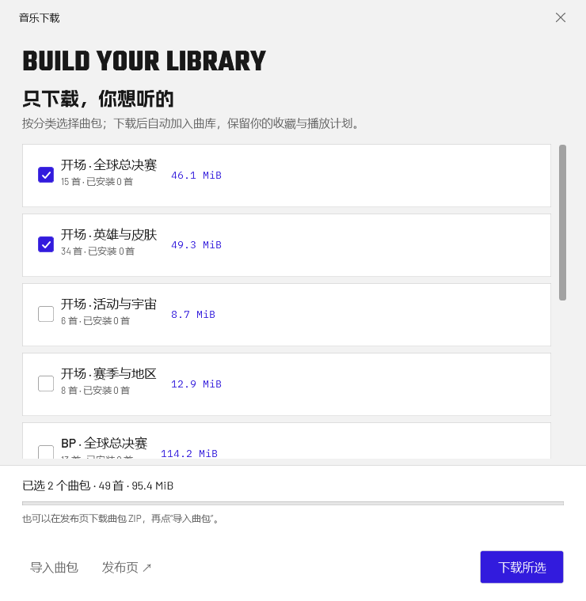
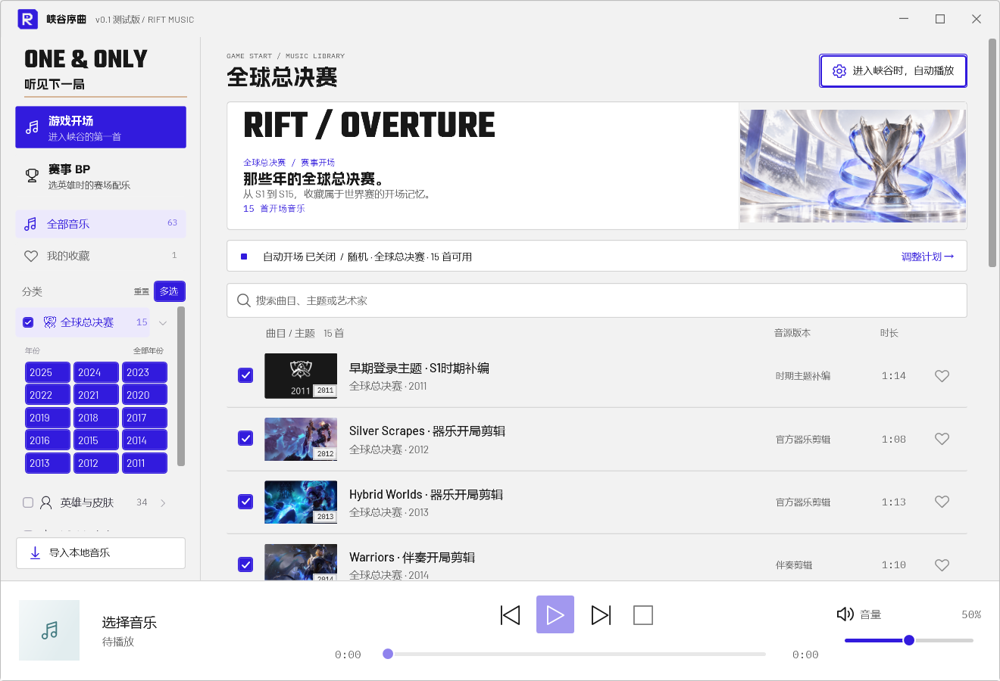
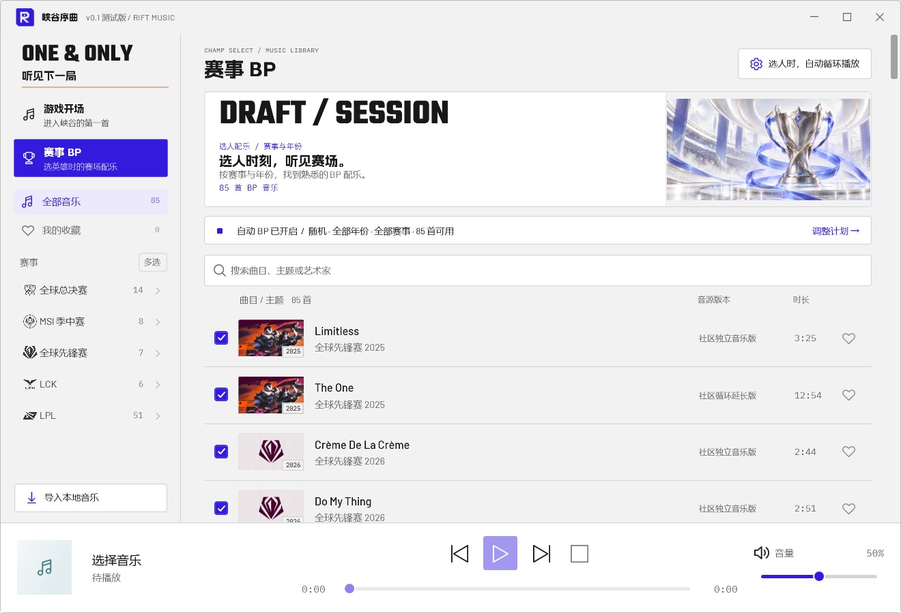

# 峡谷序曲 · v0.1 测试版

把熟悉的 LOL 开场旋律，带回下一局。

Windows 桌面音乐助手：按年份、赛事和主题浏览开场音乐与 BP 配乐，支持试听、收藏、本地导入及独立的自动播放计划。浅色界面参考 Worlds 2022 的配色与排版。

**首次公开测试版，不是稳定正式版。** 国服 / WeGame 真实选人与实战自动触发尚未完成验证。界面、音频播放与检测逻辑测试不等于实战验证。

## 下载与运行

到 [v0.1 下载页](https://github.com/CHO-CYQ/rift-music/releases/tag/v0.1)，展开页面底部的 **Assets**。推荐下载 **`RiftMusic-v0.1-lite-win-x64.zip`**：只包含程序，不强制下载歌曲。解压运行后，点左下角 **“下载曲库”**，按分类勾选需要的曲包，再点“下载所选”。窗口会显示曲目数、大小、进度和已安装状态，支持取消。

现有 **148 首音乐（63 首开场、85 首 BP）**拆成九个曲包：世界赛开场、英雄与皮肤、活动与宇宙、赛季与地区，以及全球总决赛 / MSI / 全球先锋赛 / LCK / LPL 的 BP 配乐。交叉赛事用途保留在曲目中；每首音频只分配到一个主曲包，全部下载可补齐现有曲库。

需要一次装齐时可选 **`RiftMusic-v0.1-full-win-x64.zip`** 完整包。`Source code (zip / tar.gz)` 是开发源码，不包含完整歌曲库，也不能直接双击运行。

解压整个 ZIP 后进入 `RiftMusic` 文件夹，双击 `RiftMusic.exe`。无需另外安装 .NET。不要单独移动 EXE，音乐和设置存放在同目录 `Data` 中。

| 想做什么 | 操作 |
| --- | --- |
| 只下载自己要听的分类 | 轻量程序 → 左下角“下载曲库” → 勾选分类 → “下载所选” |
| 软件内下载失败 | 在发布页下载名称为 `RiftMusic-Music-…-v0.1.zip` 的分类包 → 软件“下载曲库” → “导入曲包”；曲包不需要自己解压 |
| 下载软件和全部现有歌曲 | 下载完整包；校验文件为同页的 `SHA256.txt` |
| 找到下载好的音频 | 打开解压后的 `RiftMusic/Data/Music`；音频使用内部文件名，曲名和来源请在软件中查看 |
| 添加自己的歌曲 | 软件左下角“导入本地音乐”，选择已有的 MP3 / WAV 文件 |
| 找尚未收录的歌曲 | 本版不提供网易云、B 站等平台的搜索下载；请从音源发布者允许的渠道取得文件，再导入 |

公开包使用新用户默认设置：自动开场与自动 BP 默认关闭，无个人收藏、对局记录或客户端安装路径。已有用户升级时保留自己的 `Data`；先退出托盘，再替换 EXE 和说明目录。

曲包在完整下载并通过 SHA-256 校验后才安装。重复安装不会替换已有收藏和片段；取消或失败会清理本次临时下载文件，先前安装的曲包继续保留。本版按分类下载，尚不提供逐首在线下载、断点续传或平台歌曲搜索。

## 界面预览

按分类选择下载；未选择的音乐不会占用本地音频空间。

游戏开场：按主题和年份选择音乐，分别设置试听与自动开场计划。

赛事 BP：按赛事和年份浏览配乐，独立配置 BP 自动播放。

截图来自 v0.1 测试版；截图中的收藏、音量和自动播放状态是演示设置，完整下载包使用上文的新用户默认配置。

## 当前功能

| 用途 | 当前内容 |
| --- | --- |
| 游戏开场 | 63 首，世界赛、英雄皮肤、活动和赛季主题 |
| 赛事 BP | 85 首，S 赛、MSI、全球先锋赛、LCK、LPL 与核实年份 |
| 曲库管理 | 搜索、年份多选、收藏、导入 MP3 / WAV、片段与淡入淡出 |
| 播放控制 | 试听、暂停、进度、音量、上下首、托盘与单实例 |

没有合格独立音源的年份与赛事显示空态，不用占位曲目充数。“游戏内原版”“官方纯音乐剪辑”和“伴奏处理剪辑”分别标注，不把补编当作曾经的游戏原音。

## 使用

1. 左侧先选“游戏开场”或“赛事 BP”，再选分类和年份；需要组合时开启“多选”。这些筛选仅影响浏览。
2. 单击选择、双击试听、爱心收藏。底部控制暂停、进度与音量。`Ctrl+F` 搜索，`Esc` 关闭设置。
3. 点击自动播放摘要设置计划。随机范围、固定音乐与浏览筛选分别保存。
4. 点击“设为固定开场 / BP”才改变固定曲目。两种自动开关互相独立。
5. 关闭窗口后留在托盘；托盘右键“退出”完全关闭。

## 检测与边界

开场读取本机 Riot Live Client Data API，结合地图、开局事件、玩家信息、推进的计时和会话门控；半途启动不补播，同局避免重复触发。BP 通过本机 LeagueClient 的 lockfile 连接 LCU，读取选人阶段。

只访问本机接口，不注入、不修改游戏文件、不读取进程内存；认证信息仅在内存中使用。这不构成“官方合作”“全区服兼容”或“保证不封号”的承诺，真实客户端兼容性仍需实测。

## 开发

.NET 10 / WPF / Windows x64。`dotnet build src/RiftMusic.App --disable-build-servers` 构建；`dotnet run --project tests/RiftMusic.Tests` 运行核心检查。发行先执行 `python scripts/fetch_runtime.py`，再执行 `scripts/publish.ps1 -OutputDirectory <独立目录>`。测试输出与个人 Data 不提交到 Git。

## 素材

通用横幅是原创 AI 氛围图；年度配图使用已核实映射。字体为附许可证的风格替代，不冒充原版商业 Worlds 字体。音乐、官方图像和商标的权利归各自权利人所有，公开源码不代表取得素材再授权。项目与 Riot Games 无隶属或官方合作关系。来源及许可证见包内“说明”与 [docs](docs)。

[v0.1 测试说明](docs/release-v01.md) · [反馈问题](https://github.com/CHO-CYQ/rift-music/issues)
