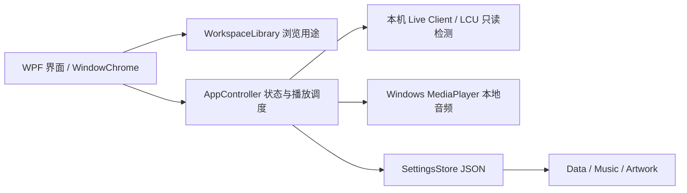

# 峡谷序曲 0.5.5：设计与架构

用途 → 全部音乐/收藏 → 分类或赛事 → 年份。全部与收藏采用独立按钮；分类默认单选切换，主动开启多选后才出现勾选框。侧栏264DIP，右侧32×40DIP箭头展开三列年份，一次展开一类；收起保留选择。年份最大184DIP，更多内容内部滚动。主题筛选在搜索旁，移除底部说明、重复分类卡片与横幅页脚。详见 sidebar-redesign-v054.md。

Core BrowseSelection 维护分类与年份配对并集，各用途保存独立浏览副本。收藏不改变自动范围；浏览和试听不改变固定曲目。关闭多选保留最后选择的一组，空选保持空态。「全部年份」与「重置」刷新后恢复键盘焦点。曲目封面96×60完整适配，用户自定义封面优先；已知旧视频图按哈希识别，用户替换同名封面继续保留。

## Worlds 2022 视觉主题

以 [Tendril 原始项目](https://tendril.studio/work/worlds2022/)为依据，使用哨兵白 #F2F2F2、雾黑 #181818、电蓝 #321BDD 和少量铜色 #D6B598。展示标题使用强窄体，功能标题使用中文 Heavy，正文保留常规字重、数据使用等宽体，圆角降为2–4。历史2022绸带参考留存；当前通用横幅采用两张原创AI氛围图，不替换历年曲目或皮肤图片。

项目没有 Manuka / Fraktion App 授权，不随包分发原字库。内置 Teko Bold / Barlow / IBM Plex Mono 作为标明身份的OFL替代，中文思源新增真实Heavy。Data/Fonts 本地原字库或系统原字库自动识别，抽屉显示实际结果。详见 worlds22-reference.md。

页面转换采用260ms模块位移与180ms淡入，抽屉短促滑入。完成后移除动画时钟，快速切换以新状态替代旧状态；停留时无循环动效。外观开关独立保存在Data/appearance.json，关闭时马上恢复完全可见的静态状态，也遵循Windows动画设置。沿用WPF原生动画体系。

## 用途与层级

一级是用途，二级是内容，页内是筛选。游戏开场与赛事 BP 在选人/进游戏的不同阶段运行，不能把 BP 排在皮肤、活动之后当作一个主题。两者的收藏、浏览状态、固定曲目和自动开关独立。

主要流程：选择用途 → 选择分类/赛事 → 筛选并试听 → 明确设置固定曲目，或在自动设置里选择随机范围。曲目勾选表示可参与自动播放；搜索只改变浏览结果。打开抽屉时顶部是实际播放计划，下部是所选曲目和来源，避免把二者混在一张卡中。

主区域统一滚动，包括标题、图片、筛选和曲目。导航与底部播放器常驻。48 DIP 窗口拖动区、16 DIP 滚动条、32 DIP 进度操作区域以及独立标题按钮，解决过小的拖动目标。浅色面板、深色正文和真实嵌入的思源 Regular/Medium，替换上一版的密集深色样式。

## 对旧界面的审查

1. 进入原曲库：开场与 BP 的139首混在「全部音乐」，BP 排在二级分类末尾；旧白色栏是 Windows 默认标题栏。新设计将用途提升一级，并用原生 WindowChrome 整合标题栏。
2. 选择 BP：原界面选中并固定 BP 后，右栏仍展示开场随机计划及龙王封面。新设计根据当前用途展示配置；赛事图片与英雄图片严格分开。
3. 浏览固定曲目：原界面仅单击就持久化覆盖固定音乐。新设计采用明确设置动作，查看和试听不覆盖计划。
4. 小窗口：旧顶部固定、列表独自滚动，右侧常驻栏挤压曲库。新设计统一滚动，设置按需展开。

旧版证据是此次实际 WPF 渲染与行为核验；最终界面也以实际原生渲染和窗口操作核查。截图不能证明实战开局触发或完整无障碍合规。

## 配图规则

曲目封面优先级：用户封面 → 已核实精确曲目 → 对应主题与年份 → 透明官方赛事标志及年份 → 中性图标。Worlds开场按对应年主题，BP按已核实年度主视觉；缺海报不借用其他年份，不重复套用2014现场照片。

横幅：全部、跨分类、未核实具体年度使用原创AI氛围图；精确分类与年份选择且有真实配图时展示对应图。AI图是通用水晶峡谷和银杯绸带，不声称官方。1774×887原图用Uniform完整适配，浅色底衔接，无黑边、文字叠层或裁切；来源仅在悬停说明中。生成模式、提示、SHA及文件路径见 ai-atmosphere-v054.md。

## 软件架构

原生 .NET10 WPF 桌面程序，采用 Core + App 分层，界面目前以 code-behind 连接控制器；不宣称完整 MVVM 架构。

WindowChrome 调整窗口外观并复用 Windows 的拖动、边缘缩放与最大化处理。UI 改动不需要改变游戏检测，不修改游戏文件。单文件 EXE 包含运行时、字体和主题图片；Data 文件夹保留音乐与用户设置，说明文件夹集中存放来源、许可证和验证证据。

## 0.5.5 播放器及字体修正

播放器自适应三段，左侧完整96×80封面、18/14文本，中间64+40DIP行，图标统一1.8矢量描边、滑块取消光晕。WindowChrome最大化按当前显示器物理工作区限制。中文标题为阿里妈妈数黑体Bold风格替代，正文微软雅黑UI/思源备用；Display排字与像素取整。详见player-repair-v055.md。
